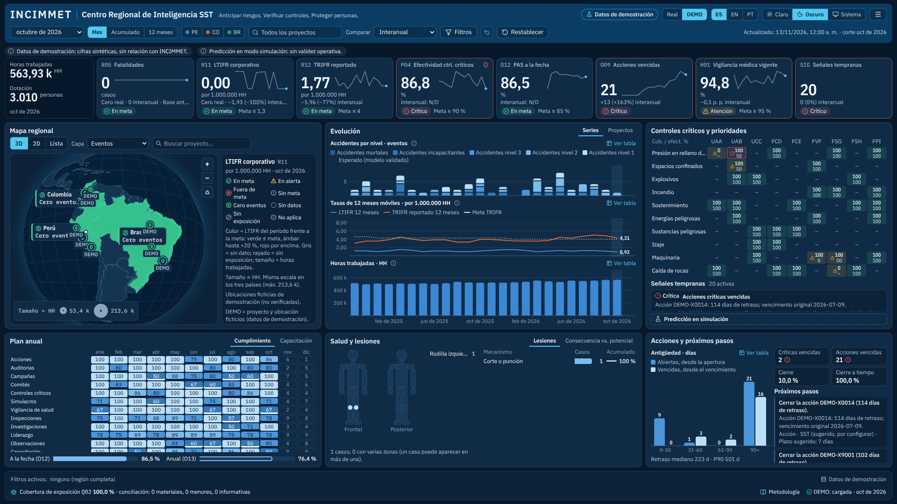

# INCIMMET | Centro Regional de Inteligencia SST

**Anticipar riesgos. Verificar controles. Proteger personas.**

Lámina ejecutiva única de Seguridad y Salud en el Trabajo para Perú, Colombia y Brasil, en español, inglés y portugués, con tema claro u oscuro.
Calcula los indicadores desde los registros de origen, concilia cada cifra con la que guarda el Excel y muestra «Fuente pendiente» donde no hay datos, sin rellenar con cifras inventadas.



## Puesta en marcha

```bash
npm install
npm run dev        # http://localhost:5173
```

Otros comandos: `npm test`, `npm run typecheck`, `npm run build`, `npm run ingest`.

Parámetros de URL: `?data=real|demo|none`, `?lang=es|en|pt`, `?theme=dark|light`.

## Acceso

La lámina abre con una pantalla de ingreso por correo y contraseña. Las credenciales nunca entran al repositorio:

```bash
INCIMMET_USERS="correo1@dominio,correo2@dominio" INCIMMET_PASSWORD="…" node scripts/auth-config.mjs
```

El comando escribe `private/auth.config.json` (ignorado por git) con huellas SHA-256 de los correos y derivaciones PBKDF2-SHA256 de la contraseña, que `vite build` incorpora al paquete. Sin ese archivo la compilación muestra «acceso no configurado».
Tras cinco intentos fallidos el ingreso se bloquea temporalmente. La sesión dura 12 horas, o 7 días si se marca «Mantener la sesión».

Esta puerta funciona en el navegador. La protección real la da el alojamiento: publique la lámina en un sitio privado o detrás de autenticación del servidor.

## Datos

Este repositorio es público: **no contiene Excel ni cifras reales**. Hay dos formas de cargar las bases.

- **En el navegador:** menú → Importar datos y suelte los tres libros. Se leen en el propio equipo y se guardan en IndexedDB; nada sale del navegador.
- **En local:** copie los libros a `private/sources/` y ejecute `npm run ingest`. Se genera `private/out/` con el conjunto de datos, el registro de conciliación y la tabla larga de estadísticas mensuales. `npm run dev` lo carga automáticamente. La carpeta `private/` está excluida de git.

El selector Real/DEMO activa un conjunto de demostración separado, siempre identificado como tal en pantalla y en las exportaciones.

## Documentación

- [Plan y esquema de la lámina](docs/PLAN.md)
- [Perfiles de importación y diccionario de datos](docs/DATOS.md)
- [Metodología de cálculo, señales y compuerta predictiva](docs/METODOLOGIA.md)
- [Verificación, pruebas y rendimiento medido](docs/VERIFICACION.md)

## Arquitectura

| Carpeta | Contenido |
|---|---|
| `src/domain` | Contratos de datos y del modelo de vista |
| `src/ingest` | Lector y escritor XLSX propios, perfiles de los tres libros, conciliación |
| `src/engine` | Cubo proyecto × mes, catálogo de KPI, señales, compuerta predictiva, calidad, DEMO |
| `src/ui` | Lámina, gráficos SVG, paneles, importador, exportaciones |
| `src/map` | Globo 3D diferido (three.js), mapa 2D (SVG) y lista accesible |
| `src/i18n` | Diccionarios ES, EN y PT-BR |

## Limitaciones conocidas

- Plan anual, controles críticos, acciones, salud, higiene y detalle de casos tienen fuente pendiente en las bases recibidas. Sus módulos muestran los requisitos y una plantilla CSV.
- Los proyectos reales no tienen coordenadas validadas: se listan junto al mapa y no se ubican hasta contar con un maestro aprobado.
- Las tasas siguen el perfil reportado por INCIMMET (niveles NV) hasta validar su equivalencia con categorías registrables.
- El modo predictivo está deshabilitado con datos reales porque el modelo no supera a la referencia simple.
- Logotipo oficial: coloque `public/brand/incimmet-logo.svg` o `.png` para sustituir el rótulo tipográfico.
- No hay control de acceso por rol: publicar con datos reales exige autenticación en una capa de servicio.
